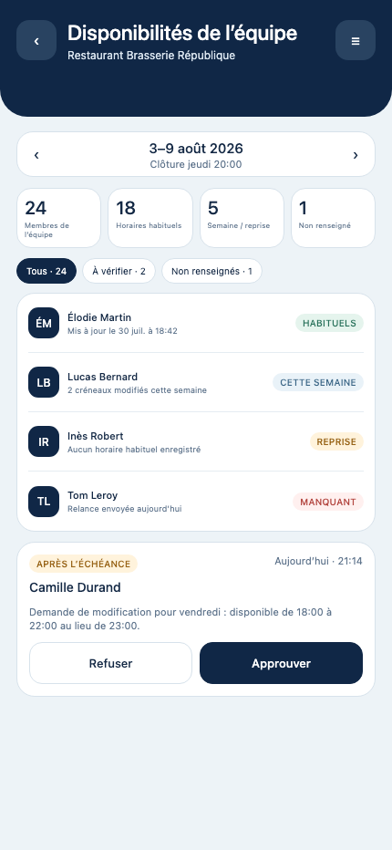
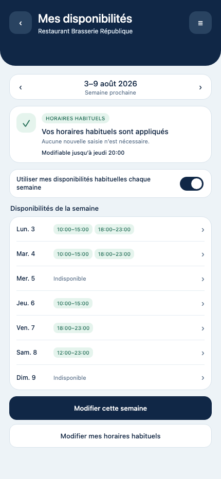
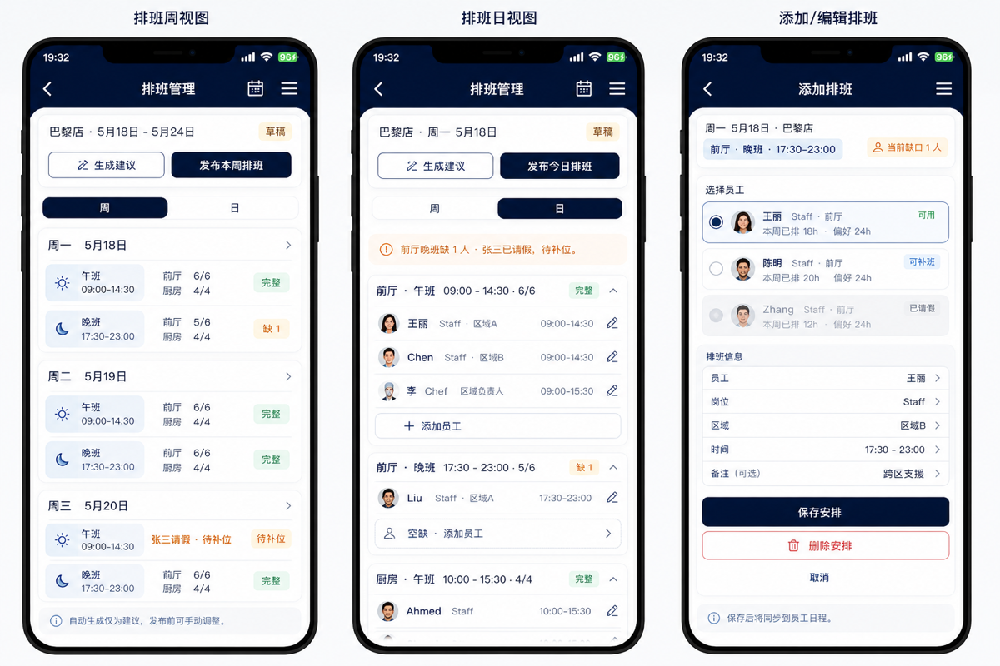
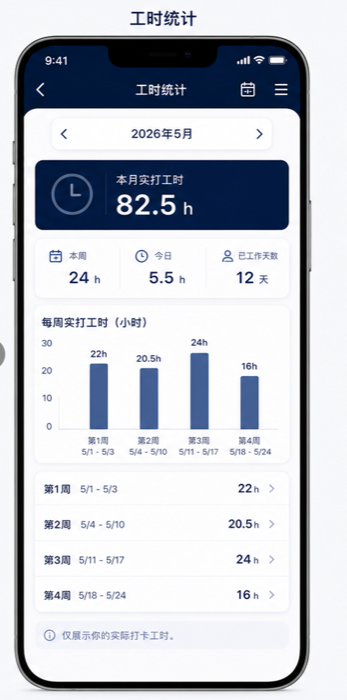
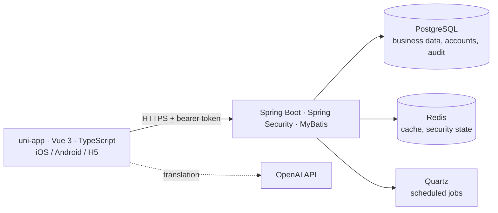

# AgendaX: staff scheduling for restaurants

A mobile app for planning shifts, collecting availability, tracking attendance and reporting hours in restaurants. It is used by managers, chefs and staff in French, English and Chinese.

> **Case study page.** AgendaX is a client project and its source code is private. This page covers the product, my role and the architecture. I can walk through the code during an interview.

| | |
|---|---|
| **Period** | March – November 2026 |
| **Status** | Pilot in a restaurant with 20–30 employees. Version 1.1.20 shipped on 31 October 2026 |
| **Team** | Me (product and front-end) and one back-end developer |
| **Platforms** | iOS, Android, web (H5) |

## My role

- **Requirements.** I collected the business rules with the restaurant owner: who can work where, opening hours, staffing needs per shift, leave and cover rules. I turned them into functional specifications, acceptance criteria and Figma mockups.
- **Scheduling logic.** I designed the constraint-based schedule generation together with the back-end developer, who built it in Spring Boot. It takes into account availability, preferences, hour caps, work-zone qualifications and conflict detection.
- **Front-end.** I built the TypeScript app (uni-app and Vue 3), including the trilingual interface. The OpenAI API handles multilingual translation.
- **Adoption.** I collected feedback from the pilot and turned it into batches of fixes. I also wrote the user guide and recorded the demo videos.

## What it does

| Area | Features |
|---|---|
| **Availability** | Staff set their usual weekly hours once and change single weeks before a deadline. Managers see who is missing and approve late changes. |
| **Scheduling** | The app suggests a week of shifts from a 7-day staffing template and shows gaps and conflicts. **Suggestions never publish themselves.** The manager edits them and publishes. |
| **Requests** | Leave, cover and swap requests go through approval. Approved full-shift leave shows up in attendance and in the monthly report. |
| **Attendance** | Each restaurant has one shared kiosk device for clock-in with a QR code that changes every 60 seconds. |
| **Hours and reports** | Weekly and monthly hours per employee, plus a separate read-only account for compliance reports. |
| **Roles** | Employee, Chef (personal view and management view), Boss/Manager, Kiosk and Public. Permissions are scoped to each restaurant. |

## Screens

| Team availability (manager) | My availability (employee) |
|---|---|
|  |  |

*Screens from the app with demo data. The restaurant and people are fictional.*

**Design specs** used to agree on the schedule and hours screens with the client (Chinese version):

## Architecture

- **Access control.** Authorisation is checked on the server. A restaurant ID in a URL never grants access by itself, and each module reloads separately when a manager switches restaurant.
- **Time zone.** Business dates and "today" always use `Europe/Paris`, whatever time zone the device is in.
- **Deployment.** Separate testing and production environments, with a standby host for production.
- **Quality.** Playwright end-to-end tests, a dated QA checklist and full-stack integration test reports. Releases are retested on iPhone and Android phones.

## Changes from the pilot

Real use in the restaurant changed the product several times:

- **Several chefs per restaurant.** Management rights are per restaurant, not one manager per site.
- **No daily hours cap.** It was removed during the pilot.
- **Work zones.** Zones such as front of house or kitchen became a configurable list per restaurant. Each employee can have qualifications (*primary / qualified / backup*) for several zones.
- **Lunch and dinner shifts.** Default shift names and a cover-request entry point were added based on feedback from testing.

## Stack

`TypeScript` `Vue 3` `uni-app` `Spring Boot` `PostgreSQL` `Redis` `Docker` `Railway` `OpenAI API` `Playwright` `Figma`
